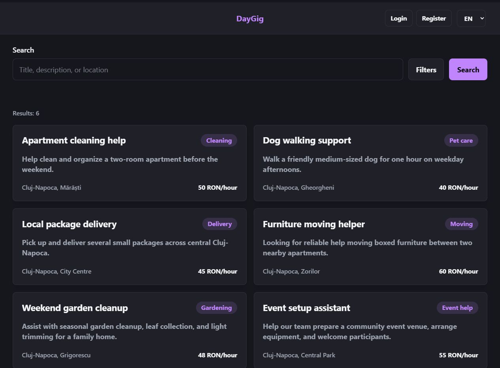
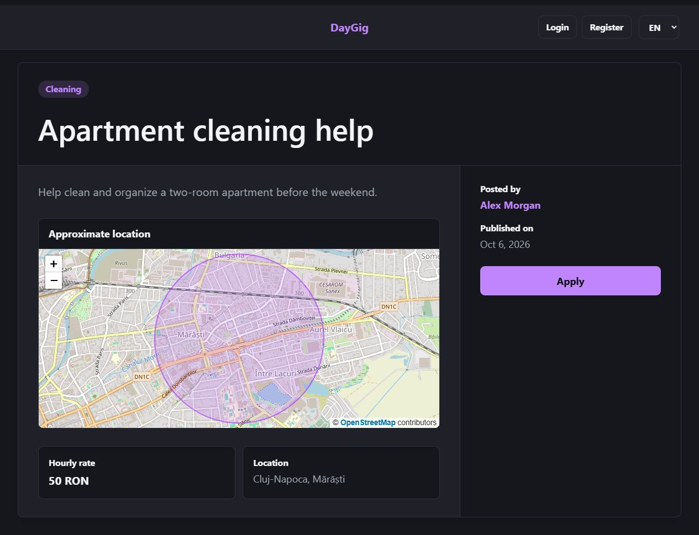
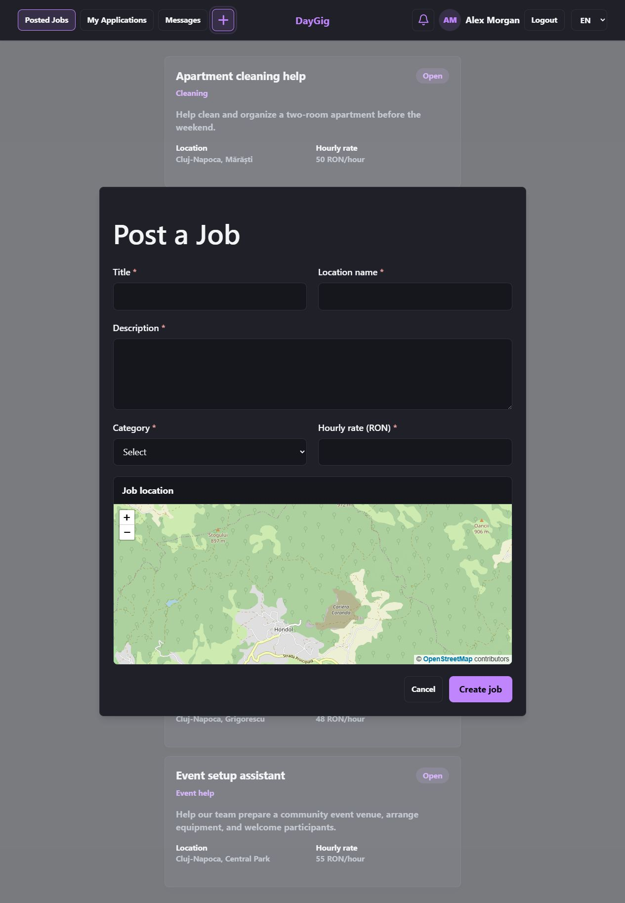

# DayGig

A marketplace connecting people who need help with everyday tasks to local workers looking for flexible, short-term gigs. Features include location-based job discovery, real-time messaging, and two-way reviews.

_Built as an MSc Software Engineering dissertation project (2026)._

---

## Screenshots

|                   Search & Filters                    |                   Job Details                    |                   Post a Job                   |
| :---------------------------------------------------: | :----------------------------------------------: | :--------------------------------------------: |
|  |  |  |

---

## Features

- **Authentication:** JWT stored in secure `httpOnly` cookies.
- **Search & Map:** Filter by keyword, category, or hourly rate; approximate location view via Leaflet and OpenStreetMap.
- **Job Workflow:** Application tracking and status management for both posters and applicants.
- **Real-Time Chat:** 1-on-1 direct messaging over WebSocket / STOMP.
- **Reviews:** Mutual ratings and feedback after a job is completed.
- **Notifications:** In-app updates and optional email alerts powered by RabbitMQ events.
- **Multilingual:** English, Hungarian, and Romanian interface support.

---

## Tech Stack

- **Frontend:** React 19, TypeScript, Vite, Tailwind CSS, TanStack Query
- **Backend:** Java 21, Spring Boot 4, Spring Security, Spring Data JPA
- **Database:** PostgreSQL 17 + PostGIS, Flyway
- **Messaging:** RabbitMQ (STOMP relay and async domain events)
- **Testing & CI:** JUnit 5, ArchUnit, Vitest, Docker, GitHub Actions

---

## Architecture Overview

```text
[Browser: React]
       │
    (Nginx)
    ┌──┴──┐
    ▼     ▼
[Spring Boot (API 1 & 2)] ──┬──> [PostgreSQL + PostGIS]
                            ├──> [RabbitMQ]
                            └──> [SMTP Mailer]
```

---

## Quick Start (Docker)

Spin up the entire scaled stack (2 API instances, Nginx, PostgreSQL, RabbitMQ) with a single command:

```bash
docker compose -f docker-compose.scale.yml up --build
```

- **App:** [http://localhost:8090](http://localhost:8090)
- **RabbitMQ Dashboard:** [http://localhost:15673](http://localhost:15673) (`daygig` / `daygig`)

To shut down:

```bash
docker compose -f docker-compose.scale.yml down
```

---

## Local Development

### 1. Start Database & Message Broker

```bash
docker compose up -d
```

_(PostgreSQL runs on `localhost:5433`, RabbitMQ on `localhost:5672`)_

### 2. Run the Backend

macOS/Linux:

```bash
cd backend
./gradlew bootRun
```

Windows:

```powershell
cd backend
.\gradlew.bat bootRun
```

- API root: [http://localhost:8080/api](http://localhost:8080/api)
- Swagger UI: [http://localhost:8080/api/swagger-ui.html](http://localhost:8080/api/swagger-ui.html)

### 3. Run the Frontend

```bash
cd frontend
npm ci
npm run dev
```

Open [http://localhost:5173](http://localhost:5173) _(Vite proxies `/api` calls to the backend)_.

---

## Configuration

Common optional environment variables:

| Variable                          | Description                 | Default     |
| --------------------------------- | --------------------------- | ----------- |
| `JWT_SECRET`                      | Signing key for auth tokens | Dev default |
| `JWT_EXPIRATION_MINUTES`          | Token validity              | `720`       |
| `MAIL_ENABLED`                    | Enable outbound emails      | `false`     |
| `MAIL_USERNAME` / `MAIL_PASSWORD` | SMTP credentials            | Empty       |
| `MESSAGING_ENABLED`               | RabbitMQ event publishing   | `true`      |
| `STOMP_RELAY_ENABLED`             | RabbitMQ as WebSocket relay | `false`     |

---

## Running Tests

```bash
# Backend tests & checks (Checkstyle, JaCoCo)
cd backend && ./gradlew build

# Frontend tests & linting
cd frontend && npm test && npm run lint
```

---

## Repository Structure

```text
daygig/
|-- backend/                  Spring Boot API & database migrations
|-- frontend/                 React client application
|-- rabbitmq/                 RabbitMQ setup & plugins
|-- docs/screenshots/         Preview assets
|-- docker-compose.yaml       Local DB & RabbitMQ setup
`-- docker-compose.scale.yml  Full scaled Docker environment
```

---

## Author

**Gergely-Vince Ágoston**  
[GitHub Profile](https://github.com/gergoagoston)
